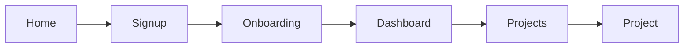

# 3. App Flow

**What it is:** a map of how people move through your app — the phases, the navigation, the user journeys, and exactly what happens when someone clicks a button (including which page comes next and what happens when something goes wrong).

**Why your agent needs it:** it's what stops "the button does nothing" and "where does this page go?" bugs. The agent wires screens together the way you imagined.

---

## Copy this prompt into Claude or ChatGPT

```
You are a senior UX designer. Help me write the App Flow document for my app.

Here are my PRD and TRD:
[paste both]

Ask me questions first if any journey is unclear. Then write, in Markdown:

1. Sitemap — every page/screen, grouped (public pages, signed-in pages, admin pages), with its URL path
2. Navigation — what's in the main menu, and what each role sees
3. Key user journeys — for each important task, numbered steps from start to finish
   (e.g. "Sign up → verify email → onboarding → dashboard")
4. Screen-by-screen behaviour — for each screen:
   - what it shows
   - every button/action and exactly what happens: what is saved, what message appears, which page comes next
   - empty state (no data yet), loading state, and error states
5. Access rules — which screens need sign-in or a specific role, and where people are sent if they don't have access
6. A Mermaid flowchart of the main journeys

Be concrete. Write "clicking Save stores the project and opens /projects/[id]", not "the user saves".
```

---

## Template

```markdown
# App Flow: [App name]

## 1. Sitemap
- Public: `/` Home, `/pricing`, `/login`, `/signup`
- Signed in: `/dashboard`, `/projects`, `/projects/[id]`, `/settings`
- Admin: `/admin`

## 2. Navigation
- Main menu (user): Dashboard · Projects · Settings
- Main menu (admin): + Admin

## 3. Key journeys
### Sign up
1. Visitor clicks **Get started** on `/`
2. Fills the form on `/signup` → account created
3. Sent to `/onboarding`, then `/dashboard`

## 4. Screens
### /projects
- Shows: list of the user's projects, newest first
- Actions:
  - **New project** → opens a form; **Save** creates it and opens `/projects/[id]`
  - **Delete** → asks "Are you sure?"; on yes, removes it and shows "Deleted"
- Empty state: "No projects yet — create your first one" + button
- Errors: "Couldn't load projects. Try again." with a retry button

## 5. Access rules
- Not signed in → sent to `/login`, then back to the page they wanted
- Non-admin opening `/admin` → sent to `/dashboard`

## 6. Flowchart

```
