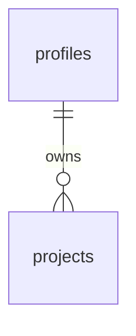

# 5. Backend Schema

**What it is:** how your app's data is stored and organised — every table, its columns and types, how tables relate to each other, the sign-in (authentication) flow, and who is allowed to read or change what.

**Why your agent needs it:** the database is the hardest thing to change later. Agreeing it up front prevents messy data, missing fields and security holes (like users seeing each other's data).

---

## Copy this prompt into Claude or ChatGPT

```
You are a senior backend engineer. Help me design the backend schema for my app.

Here are my PRD, TRD and App Flow:
[paste all three]

Ask me about anything unclear first (e.g. can one user belong to several teams? can records be deleted or only archived?). Then write, in Markdown:

1. Authentication flow — how people sign up, sign in, reset passwords and sign out; how roles are assigned
2. Tables — for each table:
   - its purpose in one line
   - every column: name, type, required or optional, default, and a short note
   - primary key, foreign keys, unique rules, and indexes
3. Relationships — in words (e.g. "a user has many projects") and as a Mermaid ER diagram
4. Access rules — for each table, who can read, create, update and delete rows (e.g. "users only their own rows; admins all"). If using Supabase/Postgres, describe the row-level security policies.
5. Files — what gets uploaded, where it's stored, and who can open it
6. Audit and history — what changes are recorded and how (created_at, updated_at, who changed what)
7. Seed / demo data — a few example rows for testing
8. Migration notes — how the schema will be created and changed safely

Use clear snake_case names. Every table gets id, created_at and updated_at. Never store passwords yourself — use the auth provider.
```

---

## Template

```markdown
# Backend Schema: [App name]

## 1. Authentication
- Sign up with email + password → email verification → profile row created
- Roles: `user` (default), `admin` (set by an admin only)

## 2. Tables
### profiles
Purpose: one row per signed-in person.
| Column | Type | Required | Notes |
|---|---|---|---|
| id | uuid | yes | same as the auth user id |
| full_name | text | yes | |
| role | text | yes | `user` or `admin`, default `user` |
| created_at | timestamptz | yes | default now() |

### projects
Purpose: [what a project is].
| Column | Type | Required | Notes |
|---|---|---|---|
| id | uuid | yes | primary key |
| owner_id | uuid | yes | → profiles.id |
| name | text | yes | |
| status | text | yes | `active` / `archived` |
| created_at | timestamptz | yes | |
| updated_at | timestamptz | yes | |
Indexes: owner_id

## 3. Relationships
- A profile has many projects.


## 4. Access rules
| Table | Read | Create | Update | Delete |
|---|---|---|---|---|
| profiles | own row; admins all | on sign-up | own name; admins all | admins |
| projects | owner; admins | signed-in users | owner | owner |

## 5. Files
- Project attachments in a private bucket; only the project owner can open them.

## 6. Audit and history
- created_at / updated_at on every table; an `activity_log` table records who did what.

## 7. Seed data
- 2 users (one admin), 3 example projects.

## 8. Migrations
- Every change is a numbered migration file, tried on development before production.
```
